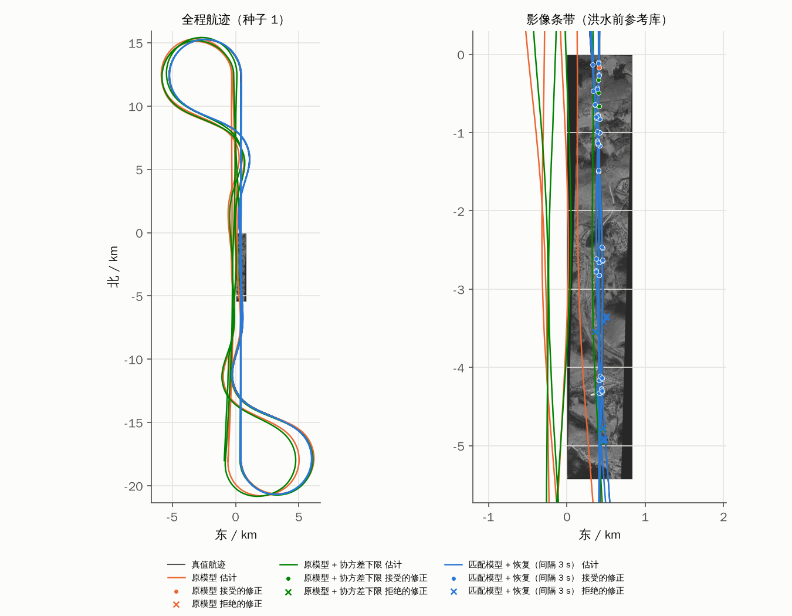
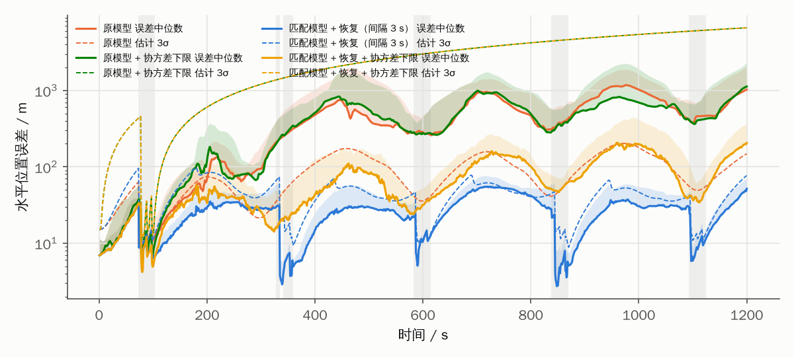
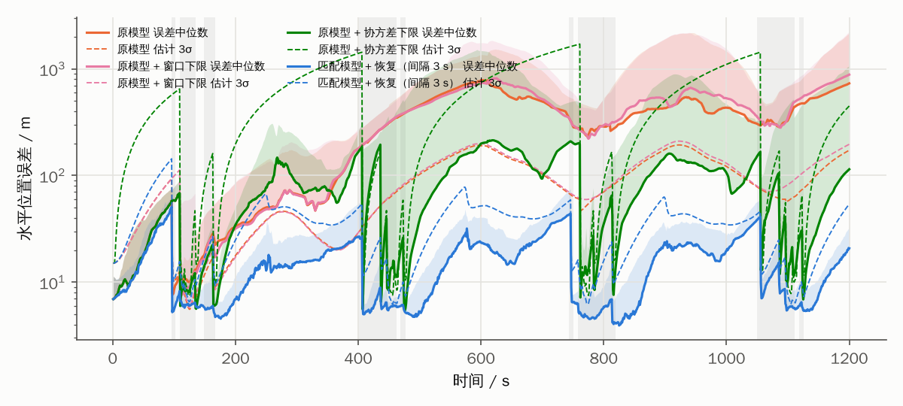

# 论文 demo：图像在环的闭环导航仿真

> 代码：[`demo/nav_demo.cpp`](../demo/nav_demo.cpp)（导航核心 `nav/` + 视觉库 `vision/`）。
> 结果：[`results/demo/`](../results/demo)（Ahr 河谷）与 [`results/demo_la/`](../results/demo_la)（Louisiana，第 6 节）。
> `demo_runs.csv` 每次运行一行，`demo_fixes.csv` 每次匹配一行，`demo_summary.md` 汇总表；
> 逐秒时间序列 `demo_series.csv` 不入库，重跑即可生成。

前面的实验（[experiments.md](experiments.md) E1–E6）里，景象匹配量测由统计模型生成。本 demo 把真实影像上的
景象匹配器直接接进闭环：每个关键帧都按真值位姿渲染机载图像，再以导航当前的估计位姿和估计 σ 为先验去匹配。
这样导航误差会反过来影响匹配：估计 σ 决定搜索窗口，估计姿态决定正射校正。这一耦合是统计模型表达不了的。

## 1. 场景

| 项 | 设置 |
|---|---|
| 区域 | 德国 Ahr 河谷影像条带 0.84 km × 5.43 km（森林山地 + 城镇 + 河流），Copernicus 30 m DEM，地形高差约 200 m |
| 参考库 / 实时图 | SpaceNet 8 洪水前影像（1 m 参考库）/ 洪水后影像（不同卫星与时相）按真值位姿渲染，含地形视差 |
| 航线 | 600 km/h、离地约 1 km，沿条带中线往返；条带两端各延伸 12 km 后以 45° 坡度限制掉头，由航线跟踪制导律重新切入（每 255 s 飞越一次条带，20 分钟共 5 次） |
| 景象匹配 | 飞越条带时 1 Hz 关键帧；DEM 正射校正 → CLAHE + 掩膜 NCC（搜索窗 3σ + 20 m，σ 取滤波器估计值，限 10–400 m）→ SIFT 精化 → 量测 σ 分级；时延 250 ms |
| 其他传感器 | `profile=realistic` 的 IMU（零偏温漂、比例因子、子步真值）与统计 VO（0.8% 常值 + 0.5% 时变尺度）、空速、气压、磁航向；不用三维地形匹配 |
| 次数 | 每种滤波配置 16 个随机种子；各配置看到同一组图像噪声 |



## 2. 结果

| 配置 | RMS 中位数 | RMS 95% | 终值误差中位数 | 锁死运行比例 | 正确匹配被拒 | 错误匹配被接受 | 恢复次数 | 位置 ANEES |
|---|---|---|---|---|---|---|---|---|
| 原模型 | 619 m | 936 m | 1030 m | 44% | 48/201 | 4/116 | 0 | 229 |
| 原模型 + 恢复（间隔 3 s） | 588 m | 963 m | 1076 m | 38% | 22/206 | 7/101 | 10 | 253 |
| 匹配模型 | **29.9 m** | **39.7 m** | 51.6 m | 6% | 3/696 | **0/117** | 0 | **1.7** |
| 匹配模型 + 恢复（K = 2） | 40.8 m | 55.8 m | 39.2 m | 0% | 6/706 | 16/110 | 18 | 2.5 |
| 匹配模型 + 恢复（间隔 3 s） | **29.9 m** | **39.7 m** | 51.6 m | 6% | 3/696 | **0/117** | 0 | **1.7** |
| 原模型 + 协方差下限 | 652 m | 1063 m | 1142 m | 0% | 0/128 | 0/48 | 0 | 1.7 |
| 匹配模型 + 恢复 + 协方差下限 | 96.2 m | 184 m | 205 m | 0% | 0/136 | 0/49 | 0 | 0.2 |

（协方差下限两行见第 6 节；在这条 0.84 km 宽的条带上它是有害的。加入由粗到精匹配后重跑，前五行与之前逐位相同。）

| 配置 | 景象匹配尝试帧 | 匹配器报告 | 报告率 |
|---|---|---|---|
| 原模型 | 2720 | 317 | **12%** |
| 匹配模型 | 2720 | 813 | **30%** |

（“错误匹配”指与量测时刻真值相差 > 30 m 的报告；“锁死”指连续 ≥ 2 次正确匹配被拒。“匹配模型”= VO 尺度一阶马尔可夫
σ 1%、τ 120 s，加计零偏随机游走 4e-4 m/s²/√s，与 E2 相同。）



## 3. 发现

**(1) 过程噪声与真实误差匹配是首要手段。** 同一组图像下，原模型 RMS 中位数 619 m、ANEES 229；匹配模型 29.9 m、
ANEES 1.7。每次飞越条带后，匹配模型的误差都回到 3–10 m，估计 3σ 包住实际误差；原模型的 3σ 比实际误差小一个量级。

**(2) 图像在环时，锁死发生在匹配器里，比 χ² 门限更早。** 原模型的估计 σ 过小，3σ 搜索窗口经常没有覆盖真实位置，
匹配器直接报告失败或找到窗口内的次优峰。匹配器报告率从 30% 掉到 12%，到达门限的正确修正反而不多（201 次，匹配模型 696 次）。
因此基于“被拒修正”的锁死恢复几乎无从触发：加上恢复后 RMS 只从 619 m 降到 588 m。统计量测模型（E1–E6）假设
量测总能产生，看不到这一层。论文的机理分析需要把“门限锁死”扩展为**门限 + 搜索窗口的双重锁死**：估计协方差同时决定
“能不能找到”和“找到后信不信”。

**(3) 真实错误匹配与地物绑定，会在相邻关键帧重复出现。** 条带上有几处地物，每次飞越都会在同样位置产生 55–95 m 的错误匹配，
而且 1 Hz 关键帧的视场重叠约 55%，同一个错误匹配会在相邻两帧重复。原恢复判据“连续 2 次被拒且相互一致”
把这种重复当成锁死的证据：16 个种子全部在同一位置（t ≈ 102 s）误接，RMS 从 29.9 m 升到 40.8 m。E5 的统计模型
假设错误匹配相互独立，因此没有暴露这个问题。

**(4) 改进：被拒修正必须间隔足够远才计为独立证据。** 只把间隔 ≥ 3 s（≥ 视场幅宽 384 m / 地速 167 m/s ≈ 2.3 s）
的被拒修正计入一致性检验（`LockoutRecoveryConfig::min_separation_s`）。之后误接降为 0，结果与不加恢复的匹配模型完全相同：
匹配模型下真正的锁死很少，恢复没有被触发。代价是恢复最快要等 3 s。

## 4. 局限

- 条带只有 0.84 km 宽。原模型误差达到数百米后，搜索区域大部分落在条带外，大窗口的对策在这里无法发挥作用，
  见第 6 节在 Louisiana 区域上的评估。
- VO 仍为统计模型，没有逐帧渲染（30 Hz × 1200 s 的渲染代价太高）；其尺度误差参数来自 `vision_eval_vo` 的实测范围。
- 匹配器为经典方法（NCC + SIFT），跨时相报告率约 30%，精匹配全部失败，因此没有航向量测。
- 渲染无法再现建筑倾斜、BRDF 与季节差异；16 个种子只覆盖一条航线和一个区域。

## 5. 下一步工作评估

按对论文的贡献排序：

1. **匹配器层锁死的对策与更宽的参考区域（最高优先级，已完成，见第 6 节）。** 发现 (2) 是本 demo 最有论文价值的结果，但对策还没验证。
   需要 ≥ 5 km 宽的多时相正射影像（SpaceNet 8 Louisiana 区域、或 NAIP 多年份）。在此基础上比较三种做法：
   搜索窗口下限（按漂移率或按距上次修正的时间）、多分辨率由粗到精搜索、以及分区段的多假设匹配。
2. **锁死条件的解析推导（已完成 VO 尺度通道，见 [lockout-theory.md](lockout-theory.md)）。** 由稳态协方差与时间相关误差的功率谱给出锁死阈值，与 E3/E3b 的 Monte-Carlo 曲线和本 demo 的
   报告率下降对照。这是方法部分的理论核心。
3. **学习型跨时相匹配器。** 30% 报告率和没有航向量测是当前实际性能的瓶颈。接口已与 SceneMatcher 对齐，
   但需要能下载模型权重的环境（当前环境无法访问 huggingface）。
4. **错误匹配的空间相关模型。** 用发现 (3) 修正 E5：错误匹配按地物位置重复出现，而不是独立出现。
   可以从 `demo_fixes.csv` 统计每处错误匹配的重复率与偏移，回灌到统计仿真。
5. **VO 图像在环与 TERCOM 闭环。** 前者需要 GPU 或降低帧率，后者已有批处理匹配代码。两者都能增强 demo 的说服力，
   但不是论文主线。

## 6. Louisiana 区域：搜索窗口锁死的对策

### 6.1 场景与匹配器改动

- 区域：SpaceNet 8 Louisiana-East（新奥尔良以东），5.5 km × 17 km 的 1 m 地图（有缺块），平原城郊、湿地与水体，
  Copernicus 30 m DEM。航线沿地图中线南北往返，其余设置与第 1 节相同，每种配置 8 个种子。
- 匹配器报告率：跨时相、先验 σ 50 m 时 31%（150 帧随机位姿，与 Ahr 的 30% 相当）。
- **由粗到精匹配。** 搜索半径超过 250 m 时，先在 4 倍降采样的参考图上做 NCC，取前 3 个峰，
  再在全分辨率 ±60 m 内精化；歧义比取最佳候选与其他候选峰之比。在同一组 150 帧上与单级全分辨率 NCC 对照：

| 先验 σ | 由粗到精：报告率 / 错误匹配占比 / 单帧耗时 | 单级 NCC：报告率 / 错误匹配占比 / 单帧耗时 |
|---|---|---|
| 150 m | 25% / 2.6% / 278 ms | 22% / 6.1% / 425 ms |
| 400 m | 13% / 0% / 347 ms | 13% / 5.3% / 1823 ms |

  报告率没有下降，错误匹配更少（候选峰之间的歧义比更严格），单帧快 1.5–5 倍。σ 1 km 时由粗到精约 0.8 s，单级 NCC 约 12 s。
  同时可以看到大窗口本身的代价：先验 σ 从 50 m 增大到 400 m，报告率从 31% 降到 13%，因为窗口内相似地物更多，歧义检验更难通过。

### 6.2 两种对策

1. **搜索窗口下限（`window`）**：只改匹配器。先验 σ 取 max(σ_滤波, 2 m/s × 距上次被接受修正的时间)，上限 1 km；
   滤波器协方差不变。
2. **协方差下限（`floor`）**：改滤波器。`NavCore::applySigmaFloor` 在发布 σ 之前把水平位置方差抬高到
   (2 m/s × 距上次被接受修正的时间)²（`LockoutRecoveryConfig::sigma_floor_rate`），只改水平位置两项，不改速度和姿态。
   这样搜索窗口和 χ² 门限由同一个协方差决定，两者同时放大。

### 6.3 结果

> 本节表格为最初 8 个种子的结果；16 个种子的统一重跑见第 7 节和 `results/demo_la/demo_summary.md`，结论不变。

| 配置 | RMS 中位数 | RMS 95% | 终值误差中位数 | 锁死运行比例 | 最长锁死 | 正确匹配被拒 | 错误匹配被接受 | 位置 ANEES | 报告率 |
|---|---|---|---|---|---|---|---|---|---|
| 原模型 | 518 m | 1059 m | 928 m | 50% | 661 s | 25/183 | 9/82 | 376 | 8% |
| 原模型 + 窗口下限 | 528 m | 1094 m | 1041 m | 100% | 999 s | 108/238 | 0/2 | 316 | 7% |
| 原模型 + 恢复 + 窗口下限 | 329 m | 1254 m | 987 m | 100% | 347 s | 51/340 | 0/4 | 298 | 10% |
| **原模型 + 协方差下限** | **169 m** | **577 m** | **114 m** | 25% | **4 s** | 8/530 | 5/21 | **5.2** | **17%** |
| 原模型 + 恢复 + 协方差下限 | 169 m | 617 m | 114 m | 25% | 2 s | 5/524 | 7/25 | 7.6 | 16% |
| 匹配模型 + 恢复（间隔 3 s） | 18.8 m | 26.8 m | 20.8 m | 0% | — | 0/730 | 0/20 | 1.2 | 23% |
| 匹配模型 + 恢复 + 窗口下限 | 21.4 m | 29.9 m | 21.7 m | 0% | — | 1/684 | 0/1 | 1.3 | 21% |
| 匹配模型 + 恢复 + 协方差下限 | 27.2 m | 38.5 m | 27.9 m | 0% | — | 0/688 | 0/2 | 0.3 | 21% |



### 6.4 发现

**(5) 只放大搜索窗口会把锁死从匹配器推回门限。** 窗口下限让匹配器重新找到了真实位置
（原模型的正确修正从 183 次增加到 238 次），但滤波器 σ 没变，这些修正几乎都被 χ² 门限拒绝（108/238）。
每个种子都进入长达 700–1000 s 的门限锁死，RMS 没有改善。加上锁死恢复后有所缓解（RMS 中位数 329 m），但 95% 分位更差。
这直接验证了发现 (2) 的“双重锁死”：**搜索窗口和门限必须由同一个协方差决定，只放大其中之一没有用。**

**(6) 协方差下限同时解开两层锁死。** 把下限加在滤波器协方差上，原模型的 RMS 中位数从 518 m 降到 169 m，
终值误差从 928 m 降到 114 m，ANEES 从 376 降到 5。报告率从 8% 升到 17%，被接受的正确修正从 158 次增加到 522 次，
最长锁死从 661 s 缩短到 4 s。它的作用和第 2 节的锁死恢复互补：恢复需要先有被拒的修正，而在匹配器层锁死时被拒的修正根本不会出现。

**(7) 代价：更宽的门限会放进错误匹配，模型正确时会损失精度。** 原模型加协方差下限后，21 个错误匹配中有 5 个被接受
（原模型为 82 个中 9 个）。匹配模型本来不锁死，加下限后
RMS 从 18.8 m 升到 27.2 m、ANEES 降到 0.3：2 m/s 的下限对它过于保守，每次飞越开始时都要用几次修正把放大的 σ 收回来。
下限速率应按任务中最坏的未建模漂移选取，并与匹配器在大窗口下的歧义检验一起设计。

**(8) 两种对策都要求参考区域宽于搜索窗口。** 在 0.84 km 宽的 Ahr 条带上重跑（第 2 节表格最后两行），协方差下限有害：
两次飞越之间（约 230 s）下限增长到约 460 m，参考裁剪区大部分在条带外，匹配器直接报告“无参考”，第一次飞越之后再也没有被接受的修正，
σ 无限增长。匹配模型加下限后 RMS 从 29.9 m 升到 96 m。因此下限需要以参考库在当前航线附近的覆盖范围为上界，
覆盖不足时应改用沿航线的一维搜索或多假设匹配。

## 7. 统一重跑：自适应协方差下限与基线对比

全部配置用同一版本代码重跑（Ahr 16 个种子，Louisiana 由 8 个增加到 16 个种子；OpenCV 4.6.0、GDAL 3.8.4），
完整表格见 [`results/demo/demo_summary.md`](../results/demo/demo_summary.md) 与
[`results/demo_la/demo_summary.md`](../results/demo_la/demo_summary.md)。Ahr 前五行与第 2 节相差不超过 0.4 m；
Louisiana 的地图实际为 4.85 km × 17.0 km（`vision_build_map` 输出，第 6 节写的 5.5 km 为瓦片范围）。

**自适应协方差下限**（`*_afloor`，见软件方案 §3.6）：连续 10 个有参考覆盖的关键帧都没有被接受的修正才启用下限，
下限不超过 (地图短边/2 − 20 m)/3（Ahr 133 m，Louisiana 802 m）。

| 区域 | 配置 | RMS 中位数 | RMS 95% | 终值误差中位数 |
|---|---|---|---|---|
| Louisiana | 原模型 | 518 m | 1067 m | 731 m |
| Louisiana | 原模型 + 协方差下限 | 144 m | 580 m | 114 m |
| Louisiana | 原模型 + 自适应下限 | 98.9 m | 311 m | 64.6 m |
| Louisiana | 原模型 + 恢复 + 自适应下限 | 84.5 m | 221 m | 69.0 m |
| Louisiana | 匹配模型 + 恢复 | 19.6 m | 25.7 m | 20.8 m |
| Louisiana | 匹配模型 + 恢复 + 协方差下限 | 27.6 m | 37.2 m | 28.8 m |
| Louisiana | 匹配模型 + 恢复 + 自适应下限 | 24.2 m | 31.9 m | 28.1 m |
| Ahr | 原模型 / + 协方差下限 / + 自适应下限 | 619 / 651 / 418 m | 936 / 1063 / 872 m | 1029 / 1126 / 929 m |
| Ahr | 匹配模型 + 恢复 / + 协方差下限 / + 自适应下限 | 30.0 / 96.1 / 29.7 m | 39.7 / 184 / 60.5 m | 51.6 / 205 / 42.5 m |

- 自适应下限在两个区域都优于始终启用的下限：Louisiana 原模型 RMS 中位数 144 → 98.9 m（95% 分位 580 → 311 m），
  匹配模型的代价从 +8.0 m 降到 +4.6 m；在 0.84 km 窄条带上不再有害（匹配模型 96.1 → 29.7 m），因为覆盖上界阻止了窗口超出参考区域。
- 代价：自适应下限启用前要先经历 10 次失败的尝试，期间会出现短暂的门限锁死（Louisiana 原模型 44% 的运行出现锁死，但最长 5 s）；
  Ahr 匹配模型的 95% 分位从 39.7 m 升到 60.5 m。

**基线**（`*_sh / *_fading / *_huber / *_studentt`，不用恢复与下限）：

- 原模型下没有一种基线能解开锁死：Louisiana RMS 中位数 415–571 m，Ahr 566–585 m，与原模型（518 / 619 m）同量级。
  原因与第 3 节发现 (2) 相同：锁死首先发生在匹配器（报告率 10–12%），而这些方法只改变“找到之后怎么用”。
- 匹配模型下，Student-t VB 与 Sage–Husa R 和本文的匹配模型 + 恢复相当（Louisiana 19.3 / 20.4 vs 19.6 m）；
  Huber 中位数相近但尾部差（95% 分位 60 m），自适应渐消明显变差（68.3 m）。

## 8. 复现

```bash
cmake -B build && cmake --build build -j          # 需要 OpenCV（vision_build_map 另需 GDAL）
tools/download_data.sh data && build/vision/vision_build_map data
build/demo/nav_demo runs=16 threads=4 max_prior=400 out=results/demo/demo \
    variants=original,original_recovery_sep,matched,matched_recovery,matched_recovery_sep,original_floor,matched_recovery_sep_floor,original_afloor,original_recovery_sep_afloor,matched_recovery_sep_afloor,original_sh,original_fading,original_huber,original_studentt,matched_sh,matched_fading,matched_huber,matched_studentt
python3 tools/plot_demo.py results/demo/demo                    # 4 核约 50 分钟

# Louisiana（第 6、7 节）：约 1.3 GB 数据，4 核约 1 小时 45 分钟
tools/download_data.sh data/la la
build/vision/vision_build_map data/la gsd=1 epsg=32615 out=data/la/la_1.00m.map
build/demo/nav_demo map=data/la/la_1.00m.map lat=29.95 lon=-89.95 runs=16 threads=4 out=results/demo_la/demo \
    variants=original,original_window,original_recovery_sep_window,original_floor,original_recovery_sep_floor,matched_recovery_sep,matched_recovery_sep_window,matched_recovery_sep_floor,original_afloor,original_recovery_sep_afloor,matched_recovery_sep_afloor,original_sh,original_fading,original_huber,original_studentt,matched_sh,matched_fading,matched_huber,matched_studentt
python3 tools/plot_demo.py results/demo_la/demo data/la/la_1.00m.map
```
