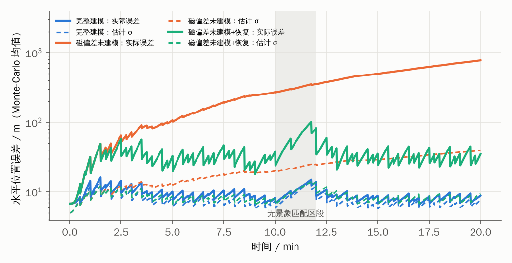
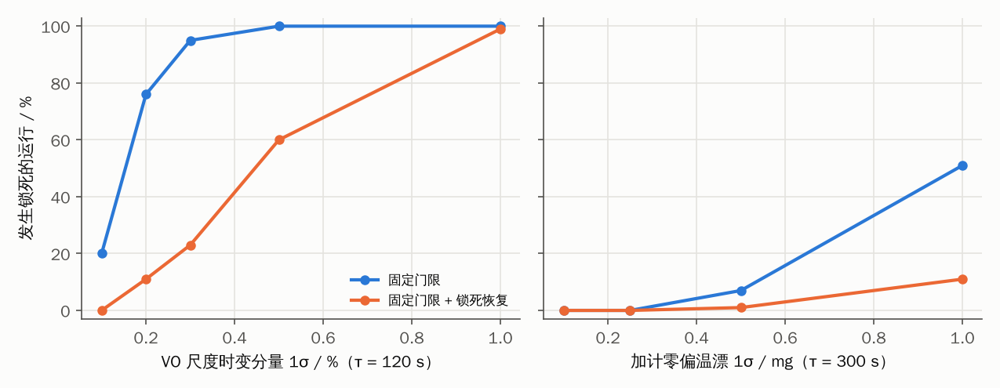
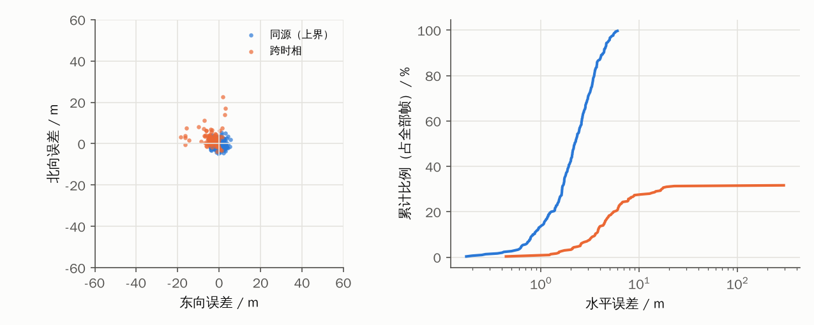
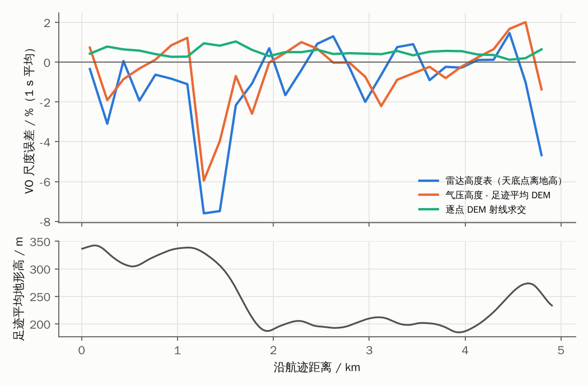

# 实验记录：门限锁死机理、鲁棒融合与真实影像上的视觉量测

> 对应论文方案 A：稀疏绝对修正下，时间相关误差建模不足导致“正确修正被错拒 → 协方差持续偏小 → 自锁发散”。
> 全部结果可复现：
>
> ```bash
> cmake -S . -B build && cmake --build build -j
> python3 tools/experiments.py --bin build/nav/nav_mc --runs 100 --out results   # 约 1–2 小时（4 核）
> tools/download_data.sh data && build/vision/vision_build_map data && build/vision/vision_eval_scene_match && build/vision/vision_eval_vo && python3 tools/plot_vision.py
> build/demo/nav_demo runs=16 variants=original,matched,matched_recovery && python3 tools/plot_demo.py   # 图像在环 demo，见 [demo.md](demo.md)
> ```
>
> 汇总表 [`results/summary.md`](../results/summary.md)，视觉评估 [`results/vision/`](../results/vision)。

## 0. 定义

- **场景**：600 km/h、1500 m 海拔、20 min（200 km），三次协调转弯；景象匹配每 30 s 一次（σ 10 m，时延 250 ms），
  第 10–12 min 无景象匹配（森林弱纹理）；三维地形匹配每 60 s；VO 30 Hz；空速、气压、磁航向。
- **默认误差模型**：仓库原有仿真（商用级 MEMS 10°/h、2 mg；VO 常值尺度 0.8%；磁偏 0.5°；远距离错误匹配 5%）。
- **更真实误差模型**（`profile=realistic`）：真值 5 子步积分（与滤波器编排不同步）、陀螺零偏温漂 3°/h 与加计零偏温漂
  0.5 mg（一阶马尔可夫，τ 300 s）、加计比例因子 300 ppm、VO 时变尺度 0.5%（τ 120 s）、**近距离错误匹配 10%（50–150 m，方向随机）**。
- **指标**：每组 100 次 Monte-Carlo。“锁死”= 连续 ≥ 2 次正确修正被 χ² 门限拒绝；ANEES 为位置 3 维 NEES 的
  Monte-Carlo 平均（理想值 3），表中给出其时间序列中位数。
- **锁死恢复**（`recovery=1`）：见 [软件方案 §3.6](software-design.md)。

## 1. E1 门限锁死的复现（默认误差模型）

| 配置 | RMS 中位数 | RMS 95% | 正确修正错拒 | 发生锁死的运行 | ANEES |
|---|---|---|---|---|---|
| 完整建模（20 维 ESKF） | **10.5 m** | 13.3 m | 0.1% | 0% | 2.7 |
| 磁航向偏差未建模 | 351 m | 752 m | 57% | 82% | 96 |
| VO 尺度未建模 | 2709 m | 3305 m | 98% | 100% | 1915 |
| 二者都未建模 | 1112 m | 1156 m | 98% | 100% | 2781 |
| 磁偏差未建模 + 恢复 | 40 m | 62 m | 11% | 16% | 57 |
| VO 尺度未建模 + 恢复 | 93 m | 314 m | 45% | 100% | 444 |
| 二者都未建模 + 恢复 | 77 m | 93 m | 36% | 57% | 573 |

- 文档中“磁航向偏差当白噪声 → 20 min 漂移约 1.3 km”在 Monte-Carlo 中得到复现（种子 1：最大 1292 m；
  100 次中 82% 发生锁死，95% 分位最长锁死 1095 s）。
- 锁死的特征是**估计 σ 与实际误差背离**（图 `results/fig_e1_lockout_timeseries.png`）：磁偏差未建模时实际误差
  单调增长到近 1 km，滤波器自报的 σ 一直停在 10–40 m。
- 锁死恢复不能替代正确建模，但把发散变成有界误差（352 m → 40 m）。



## 2. E3 / E3b 过程噪声失配的阈值

滤波器结构正确（有对应状态）但过程噪声取小时，同样发生锁死：

| 失配项（滤波器按默认随机游走建模） | 无锁死 → 多数运行锁死的临界幅度 |
|---|---|
| VO 尺度时变分量（τ 120 s） | 0.1% 时已有 20% 运行锁死，0.2% 时 76%，≥ 0.5% 时 100% |
| 加计零偏温漂（τ 300 s） | 0.5 mg 时 7%，1.0 mg 时 51% |

锁死恢复把临界幅度大约提高一倍（VO 尺度 0.2% 时 76% → 11%；加计 1.0 mg 时 51% → 11%）。

VO 尺度这一行的阈值可以用降阶解析模型预测（不拟合 E3）：锁死由“一个修正间隔内的未建模漂移 V σ_s T”与新息标准差之比决定，
并在修正间隔 15 s / 60 s 上做了样本外验证，见 [lockout-theory.md](lockout-theory.md)。



## 3. E2 更真实误差模型

| 配置 | RMS 中位数 | RMS 95% | 最大误差 95% | 正确修正错拒 | 错误匹配误接 | 锁死运行 | ANEES |
|---|---|---|---|---|---|---|---|
| 原模型（默认过程噪声） | 565 m | 4407 m | 11.9 km | 68% | 7.7% | 100% | 236 |
| 原模型 + 恢复 | 49 m | 207 m | 1.3 km | 27% | 28% | 77% | 1894 |
| 仅 VO 尺度改马尔可夫 | 134 m | 363 m | 1.2 km | 23% | 14% | 88% | 19 |
| **匹配模型** | 18.5 m | 95 m | 338 m | 3.1% | 13% | 14% | 4.6 |
| **匹配模型 + 恢复** | **18.7 m** | **32.6 m** | **143 m** | **0.9%** | 16% | **0%** | **4.5** |
| 匹配模型 + 恢复 + 匹配航向 | 19.5 m | 44.5 m | 205 m | 1.7% | 17% | 1% | 5.7 |

“匹配模型”= VO 尺度一阶马尔可夫（σ 1%，覆盖 0.8% 常值 + 0.5% 时变；τ 120 s）+ 加计零偏过程噪声按温漂量级
（4×10⁻⁴ m/s²/√s）。消融（每次去掉一项真实误差，30 次 Monte-Carlo）定位到**加计零偏温漂过程噪声失配**是只改 VO 尺度模型后仍然锁死的主因。

结论：

1. 真实误差下，仓库原来的过程噪声参数会 100% 锁死；问题不在单一误差源，而在**所有时间相关误差的过程噪声都必须覆盖实际量级**。
2. 匹配模型 + 恢复：RMS 中位数 18.7 m、95% 分位 32.6 m，无锁死，ANEES 4.5（略偏乐观）。
3. **代价**：近距离错误匹配（50–150 m）有 13–17% 落在门限内被接受。这不是恢复机制引入的（无恢复时 13%），
   而是先验 σ 与错误距离同量级时 χ² 门限本身无法区分。需要多假设或跨源一致性检验（方案 A 的下一步）。
4. 加入景象匹配航向量测在此场景没有收益（略差）；默认场景下关闭磁罗盘、只用匹配航向时 RMS 从 13.4 m 降到 8.9 m（种子 1），值得作为单独实验。

## 4. E4 时延量测处理

参考状态“叠加此后修正量”与原实现在 0.25 s 和 1.0 s 时延下指标相同（RMS 18.7 vs 18.7 m、18.9 vs 18.9 m）。
说明在 30 s 修正间隔下，时延期间的其他修正量很小，原实现的近似足够；该项不宜作为论文贡献，保留作工程完备性。

## 5. E5 / E6 错误匹配比例与修正间隔（匹配模型）

| 近距离错误匹配比例 | RMS 中位数（无恢复 / 恢复） | 锁死运行（无 / 有） | 误接率（无 / 有） |
|---|---|---|---|
| 5% | 17.4 / 17.5 m | 8% / 0% | 9.5% / 11% |
| 10% | 18.5 / 18.7 m | 14% / 0% | 13% / 16% |
| 20% | 21.3 / 23.2 m | 24% / 9% | 14% / 21% |
| 30% | 27.4 / 30.1 m | 41% / 21% | 15% / 25% |

| 景象匹配间隔 | 15 s | 30 s | 60 s | 90 s |
|---|---|---|---|---|
| RMS 中位数（恢复） | 15.1 m | 18.7 m | 26.3 m | 29.2 m |
| 错误匹配误接率 | 5.6% | 16% | 32% | 36% |

错误匹配越多，恢复机制减少锁死的作用越大，同时误接率上升，二者存在折中；修正间隔越长，先验 σ 越大，近距离错误匹配越难识别。

## 5b. E7 与自适应 / 鲁棒滤波基线的对比（更真实误差模型，100 次）

景象匹配更新方式（`fix_update`）：Sage–Husa 自适应 R、自适应渐消（新息驱动放大运动学协方差）、Huber M 估计、
Student-t 变分贝叶斯；后两者不设门限，所有修正都参与更新（大新息被降权），因此“错拒率 / 锁死”对它们没有定义，
误接率恒为 100%（被降权而不是拒绝）。另比较始终启用的协方差下限与自适应下限（连续 2 次修正未被接受才启用）。

| 过程噪声 | 更新方式 | RMS 中位数 | RMS 95% | 锁死运行 | 错误匹配误接 | ANEES |
|---|---|---|---|---|---|---|
| 原模型 | 固定门限 | 565 m | 4407 m | 100% | 7.7% | 236 |
| 原模型 | Sage–Husa R | 157 m | 641 m | 58% | 93% | 105 |
| 原模型 | 自适应渐消 | 49.7 m | 194 m | 86% | 95% | 7839 |
| 原模型 | Huber | 93.6 m | 157 m | — | （降权） | 182 |
| 原模型 | Student-t VB | 172 m | 440 m | — | （降权） | 184 |
| 原模型 | 门限 + 恢复 | 48.9 m | 207 m | 77% | 28% | 1894 |
| 原模型 | 门限 + 恢复 + 协方差下限 | 56.2 m | 803 m | 20% | 76% | 33 |
| 原模型 | 门限 + 恢复 + 自适应下限 | 48.6 m | 148 m | 67% | 27% | 851 |
| 匹配模型 | 固定门限 | 18.5 m | 95.0 m | 14% | 13% | 4.6 |
| 匹配模型 | Sage–Husa R | 24.2 m | 31.7 m | 0% | 83% | 3.2 |
| 匹配模型 | 自适应渐消 | 38.9 m | 60.2 m | 5% | 100% | 26 |
| 匹配模型 | Huber | 24.0 m | 38.8 m | — | （降权） | 5.1 |
| 匹配模型 | Student-t VB | 19.4 m | 30.9 m | — | （降权） | 3.9 |
| 匹配模型 | 门限 + 恢复 | 18.7 m | 32.5 m | 0% | 16% | 4.5 |
| 匹配模型 | 门限 + 恢复 + 协方差下限 | 31.7 m | 41.3 m | 0% | 83% | 4.4 |
| 匹配模型 | 门限 + 恢复 + 自适应下限 | 18.9 m | 32.3 m | 0% | 17% | 4.1 |

1. **没有一种自适应 / 鲁棒方法能弥补过程噪声失配。** 原模型下最好的几种（自适应渐消、门限 + 恢复、自适应下限）
   RMS 中位数都在 50 m 左右，ANEES 仍为数百到数千；匹配模型 + 恢复为 18.7 m、ANEES 4.5。过程噪声匹配仍是首要手段。
2. 把大新息当作“量测不可信”的方法（Sage–Husa R、Huber、Student-t）在锁死时方向相反：它们降低的是量测权重，
   而真正需要放大的是滤波器自己的协方差。Sage–Husa 还会把 R 估计得过大，放进 83–93% 的近距离错误匹配。
3. 匹配模型下，Student-t VB 与门限 + 恢复相当（19.4 vs 18.7 m，95% 分位 30.9 vs 32.5 m），是值得在论文中如实报告的强基线。
4. 始终启用的协方差下限在统计仿真中代价明显（匹配模型 18.7 → 31.7 m，误接 16% → 83%）；
   自适应下限把这一代价消除（18.9 m，误接 17%）。

## 6. 真实影像上的景象匹配（`vision/`，C++）

数据：德国 Ahr 河谷（森林山地 + 城镇 + 河流）0.84 km × 5.4 km 条带，SpaceNet 8 洪水前（参考库，1 m）/洪水后
（实时图，不同卫星与时相，含薄云和雾霾）两期 Maxar 影像，Copernicus 30 m DEM（地形高差约 200 m）。
相机 640×640、地面分辨率约 0.6 m、1 km 离地高；导航先验位置误差 1σ 50 m、航向 0.5°、水平姿态 0.1°；每组 300 帧。

| 条件 | 报告率 | 报告中错误匹配（> 30 m） | 正确匹配误差中位数 | 偏差（北/东） | 标准差（北/东） | NIS 均值 |
|---|---|---|---|---|---|---|
| 同源（实时图也由洪水前影像渲染，上界） | 99.7% | 0% | 2.2 m | 0.1 / −0.3 m | 1.9 / 2.0 m | 1.5 |
| 跨时相，CLAHE + NCC | 32% | 1.1% | 4.5 m | 2.5 / −3.9 m | 4.0 / 4.1 m | 1.1 |
| 跨时相，梯度幅值 + NCC | 39% | 8.5% | 4.8 m | 3.2 / −4.2 m | 6.9 / 4.5 m | 2.3 |
| 跨时相，平地正射（不用 DEM） | 30% | 1.1% | 4.6 m | — | — | 1.3 |
| 跨时相，先验 σ 150 m，单级 NCC | 15% | 4.3% | 4.8 m | — | — | 1.7 |
| 跨时相，先验 σ 150 m，由粗到精 | 25% | 1.3% | 4.7 m | — | — | 1.1 |

- 同源时 SIFT + RANSAC 精匹配位置 2.2 m、航向 0.08°；**跨时相时 SIFT 精匹配全部失败**，只能依赖 NCC 粗匹配，
  可用率降到约 30%。这量化了文档风险表中“跨季节/跨时相匹配失败”：经典方法在林区几乎不可用，学习型跨时相匹配器是必需项。
- 跨时相约 4.6 m 的系统偏差来自两期影像之间的配准差，对应误差预算中的“参考影像地理定位误差”。
- 错误匹配集中在 250–470 m（搜索窗口边缘；梯度预处理时最近 75 m），**而不是仿真中假设的 50–150 m**；远距离错误匹配会被门限拒绝，
  这说明 E2/E5 的近距离错误匹配假设偏悲观，论文中应同时给出两种错误匹配模型的结果。
- 先验 σ 150 m（搜索半径 470 m）时，由粗到精（4 倍降采样 NCC 取前 3 个峰，再在全分辨率精化）比单级 NCC 报告率更高、
  错误匹配更少、单帧耗时 368 → 195 ms。搜索半径 ≤ 250 m 时仍走单级 NCC，其他各行不受影响。
- 量测 σ 已按评估结果整定（NIS 1.1–1.7，略保守）。
- 表中为 C++ 实现的结果；早期 Python 原型同条件下为报告率 28%、误差中位数 5.3 m，差异在随机数范围内。



## 7. 真实地形上的 VO 尺度误差

沿河谷由北向南定高飞行 600 km/h、30 Hz，约 4.9 km，足迹平均地形高变化 158 m：

| 尺度来源 | 尺度误差均值 | 1 s 平均后标准差 | 相关长度 | 机体系速度误差 RMS（x / y / z） |
|---|---|---|---|---|
| 雷达高度表（天底点离地高） | −1.1% | 2.2% | ≈ 210 m | 5.0 / 3.4 / 60 m/s |
| 气压高度 − 足迹平均 DEM | −0.5% | 1.6% | ≈ 180 m | 3.3 / 1.7 / 20 m/s |
| 逐点 DEM 射线求交 | +0.5% | **0.2%** | ≈ 180 m | **1.5 / 1.2 / 0.4 m/s** |

- 山地下“平地 + 天底离地高”的尺度误差在下坡段可达 −8%（1 s 平均），且雷达高的帧间跳变会让垂向速度完全不可用。
- 逐点 DEM 射线求交把尺度误差压到 0.2–0.5%（Python 原型 0.5%），与仿真中的 VO 假设（0.8% 常值 + 0.5% 时变）同量级。
- 尺度误差相关长度约 180–260 m（600 km/h 下 1–1.5 s），比仿真假设的 τ = 120 s 短得多；短相关误差对锁死的影响较小，
  E3 的失配主要对应慢变成分（如林区冠层高度系统偏差、DEM 区域性误差），论文中需要区分这两类。



## 8. 图像在环 demo

把真实影像上的景象匹配器接进闭环（导航估计 σ 决定搜索窗口），见 [demo.md](demo.md)。要点如下：
- 匹配模型 RMS 中位数 29.9 m、ANEES 1.7，原模型为 619 m、ANEES 229；
- 原模型的锁死首先发生在匹配器：3σ 搜索窗口没有覆盖真实位置，报告率从 30% 降到 12%，基于被拒修正的恢复几乎无从触发；
- 真实错误匹配与地物绑定，会在相邻关键帧重复出现，原恢复判据（K = 2）会误接；
  要求被拒修正间隔 ≥ 3 s（视场不重叠）后误接降为 0；
- 在更宽的 Louisiana 地图上，只放大搜索窗口无效（找到的修正被 χ² 门限拒绝）；把下限加在滤波器协方差上
  （窗口与门限一起放大）后，原模型 RMS 中位数 518 m → 169 m、ANEES 376 → 5，代价是放进少量错误匹配，
  而且要求参考区域宽于搜索窗口。

## 9. 局限

- 仿真真值仍由同一套机械编排（子步积分）生成；未包含杆臂、振动整流、g 敏感误差。
- 远距离错误匹配为固定偏移（+400, −300 m），连续两次时会被锁死恢复判为“一致”而误接（推测是 E1 恢复组 2.1% 误接率的来源，尚未逐例核对）；
  真实错误匹配的方向是随机的。
- 图像渲染无法再现真实离天底视角的建筑倾斜和 BRDF；数据条带只有 5 km，景象匹配评估是随机位姿的独立帧统计，尚未闭环。
- 尚未实现：多假设匹配、跨源一致性、随机克隆、TERCOM/SITAN 进闭环、学习型匹配器（SuperPoint/LightGlue 等，当前环境无法下载模型权重）。
