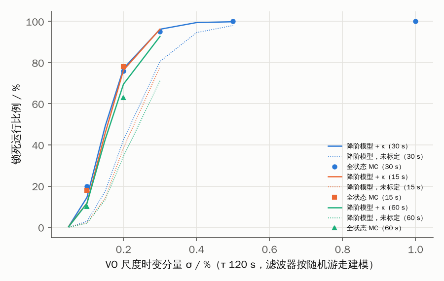

# 门限锁死条件的降阶解析模型

> 代码：[`tools/lockout_theory.py`](../tools/lockout_theory.py)（约 3 分钟）。图：`results/fig_lockout_theory.png`，预测：`results/lockout_theory_predictions.csv`。
>
> **第二版修订**（见第 5 节）：初版的真实过程噪声漏掉了交叉项，且把各次拒绝当作独立事件。两处错误方向相反、相互抵消，
> 初版“不拟合即可预测”的吻合有偶然成分。修正后的模型需要一个由锁死前 NIS 标定的参数。

E3 用 Monte-Carlo 测出了锁死阈值：滤波器结构正确，但 VO 尺度的时变分量按随机游走建模（过程噪声偏小）。
时变分量为 0.1% 时 20% 的运行锁死，0.2% 时 76%。本文用一个降阶模型解释这个阈值从何而来，
并预测它在其他幅度与修正间隔下的变化。

## 1. 模型

只保留与锁死有关的通道：沿航迹位置误差 p 与 VO 尺度误差 s。

| | 真实系统 | 滤波器模型 |
|---|---|---|
| 位置 | ṗ = V·s + w_v | ṗ = V·ŝ + w_v |
| 尺度 | 一阶马尔可夫：σ_s，τ_s = 120 s | 随机游走：q_s = (10⁻⁵)²/s（E3 的默认值） |
| 横向 | 与滤波器一致 | ṗ = w_v |

w_v 的谱密度 q_v = 0.5 m²/s 取自 E1 完整建模时修正前后 σ 的增长（每 30 s 由约 6 m 增长到约 8 m），不是从 E3 拟合的。
修正时刻与仿真默认场景相同：景象匹配从 30 s 起每 30 s 一次（R = 10²，600–720 s 无修正），
三维地形匹配从 45 s 起每 60 s 一次（R = 20²），5% 的景象匹配为错误匹配。

**次优滤波灵敏度分析。** 在增广状态 [e_p, e_s, s] 上同时传播两个协方差：
滤波器自认的协方差 P（用滤波模型），以及在滤波器增益下的真实误差协方差 E（用真实模型）。
修正时：

- 滤波器的新息协方差 S_f = P_pp + R，真实新息协方差 S_t = E_pp + R（横向两者相同）；
- NIS = (ν_a² + ν_c²)/S_f，其中 ν_a ~ N(0, S_t)，ν_c ~ N(0, S_f)。
  拒绝概率 p = P(NIS > γ) 由广义 χ² 分布给出（γ = 13.8，χ²(2) 99.9%）；
- 接受时，P 和 E 都按滤波器增益 K = P H′/S_f 以 Joseph 形式更新；拒绝时两者都不更新。

两个协方差都是确定性的，只依赖接受/拒绝的历史。因此按上述概率抽样拒绝序列，统计“连续 ≥ 2 次正确修正被拒”的
运行比例即可，锁死定义与 E3 相同。

## 2. 闭式近似

修正后，滤波器只消去未跟踪速度偏差 b = V·s 所累积位移的 K 倍；b 在相邻修正间的相关系数为 φ = e^(−T/τ)。
在不发生拒绝的稳态下：

  Δ = E⁻ − P⁻ ≈ (V σ_s T)² · G(K, φ)，  G = (1 + (1−K)φ) / ((1 − (1−K)²)(1 − (1−K)φ))

  ρ = S_t / S_f = 1 + Δ / S_f

含义：

- **锁死由“每个修正间隔内的未建模漂移 V σ_s T”与“滤波器新息标准差 √S_f”之比决定**，放大系数 G 来自跨周期累积。
  本配置下 K ≈ 0.37、G ≈ 4.9。V σ_s T 只需达到修正 σ 的 30–50%（σ_s = 0.1% 时 V σ_s T = 5 m），ρ 就升到约 1.8（全状态仿真中为 2.0）。
  这时单次拒绝概率约 1.5%，40 次修正中出现一次拒绝的概率已不可忽略。
- 一次拒绝之后，下一次修正前的累积漂移约为 2V σ_s T，ρ 增长约 4 倍，而 S_f 只线性增长，于是第二次拒绝几乎必然发生。
  正因如此，锁死概率随 σ_s 呈陡峭的 S 形，而不是缓慢增长。
- 修正间隔 T 的影响较弱：T 增大时 V σ_s T 增大，但 P⁻ 也增大（K 增大、G 减小），修正次数也变少，几项部分抵消。

闭式的 ρ − 1 比修正后的降阶数值模型大约 1.6 倍（各 σ_s 下比例相同），原因是闭式忽略了交错的三维地形修正，
也假设滤波器完全不跟踪 s；它与全状态仿真的 ρ 相差在 15% 以内（第 3 节），适合作为保守的设计估计。

## 3. 与全状态 Monte-Carlo 对照（第二版）

| σ_s | 30 s 未标定 | 30 s 标定 | E3（30 s） | 15 s 标定 | 全状态（15 s） | 60 s 标定 | 全状态（60 s） |
|---|---|---|---|---|---|---|---|
| 0.05% | 0.0% | 0.4% | — | 0.5% | — | 0.3% | — |
| 0.1% | 2.9% | 14.5% | 20% | 11.8% | 18% | 11.6% | 10% |
| 0.15% | 17.5% | 49.2% | — | 45.8% | — | 42.7% | — |
| 0.2% | 42.5% | 77.1% | 76% | 76.3% | 78% | 69.5% | 63% |
| 0.3% | 80.5% | 96.2% | 95% | 96.2% | — | 92.7% | — |
| 0.5% | 98.0% | 99.8% | 100% | — | — | — | — |

- 标定参数 κ = 2.11 只用 σ_s = 0.1%、30 s 这一点的**锁死前 NIS**（877 次正确修正）求得，没有用任何锁死比例。
  其余 σ_s 与两个修正间隔都是预测；15 s、60 s 的全状态仿真是在初版预测之后跑的。
- 标定后，三种间隔下的预测与全状态结果相差在 7 个百分点以内（60 s、0.2% 处偏高 6.5 个百分点），阈值位置与“修正间隔影响弱”都对。
- 未标定的模型把阈值放在 0.2–0.3%，比全状态晚约 1.5 倍 σ_s。

单次修正前的新息方差比 ρ（无拒绝稳态，300–600 s）：

| σ_s | 初版模型 | 修正模型 | 闭式 | 全状态（锁死前 NIS − 1） |
|---|---|---|---|---|
| 0.1% | 2.31 | 1.48 | 1.78 | 2.02 |
| 0.2% | 6.25 | 2.97 | 4.12 | 4.06 |
| 0.3% | 12.8 | 5.45 | 8.03 | 6.02（只含尚未被拒的运行，偏低） |

全状态滤波器的超额新息方差约为修正降阶模型的 2 倍，κ 即此比值。降阶模型略去的通道（转弯时沿航迹方向旋转、
空速/风与 VO 的耦合、姿态误差）是可能的来源，尚未逐一分离。闭式近似反而与全状态的 ρ 相近（±15%），可作为保守的设计估计。

## 4. 对论文的意义与局限

- 这给出了方法部分需要的机理：锁死不需要“未建模的状态”，**只要时间相关误差在一个修正间隔内造成的未建模漂移与
  新息标准差可比**就会发生。因此，状态结构和过程噪声下界都必须按“漂移 / 新息”的比值来设计，而不是只看稳态精度。
- 由此得到一条设计准则：时间相关误差源的过程噪声应保证 V σ T · √G ≲ 0.5 √S_f；不满足时，必须配合锁死恢复或保守的过程噪声。
- 图像在环 demo 中的“搜索窗口锁死”是同一个比值作用于匹配器：窗口取 3√P，当 √E 明显大于 √P 时，真实位置落在窗口外的概率由同一个 ρ 决定。
- 局限：只覆盖 VO 尺度通道。E3b 的加计漂移经由姿态/速度耦合起作用，需要增加速度与姿态状态才能纳入。
  修正后的降阶模型需要一个标定参数 κ（见第 3、5 节）。

## 5. 第二版修订说明

**错误 1：真实系统过程噪声漏项。** 尺度估计误差 e_s = s − ŝ，ŝ 在两次修正之间不变，所以 ė_s = ṡ = −s/τ + w_s：
驱动 s 的白噪声同样驱动 e_s。初版取 Q_t = diag(q_v Δ, 0, σ_s²(1−φ²))，e_s 上没有噪声，也没有 e_s–s 交叉项，
相当于让 e_s 只随 s 的衰减项变化、对 s 的随机部分做了“无界积分”，超额方差 ρ − 1 被高估约 2.7 倍。现由连续模型

  A_t = [[0, V, 0], [0, 0, −1/τ], [0, 0, −1/τ]]，G = [[1, 0], [0, 1], [0, 1]]，Q_c = diag(q_v, 2σ_s²/τ)

经 Van Loan 方法精确离散化，Q_t 含 e_s 方差、e_s–s 交叉项（两者相等，完全相关）和 e_p–e_s 积分交叉项；
滤波模型同样精确离散化。s 的初值与仿真一致取 0。

**错误 2：拒绝事件当作独立。** 初版只传播协方差，每次修正按 p(ρ) 独立抽样拒绝。但相邻修正的新息经慢变的 s
强相关（φ = 0.78），一次因 s 偏大而被拒，下一次多半也会被拒；独立抽样低估了连续拒绝的概率。
现对降阶系统本身的误差实现抽样（`lockout_prob_sampled`），用实际新息计算 NIS，4000 次实现。

两处错误方向相反：错误 1 高估 ρ，错误 2 低估连续拒绝。初版“未拟合即吻合”因此有偶然成分。
修正后需要 κ 才能与全状态结果吻合；`lockout_prob(..., exact=False)` 保留初版以便复现。
